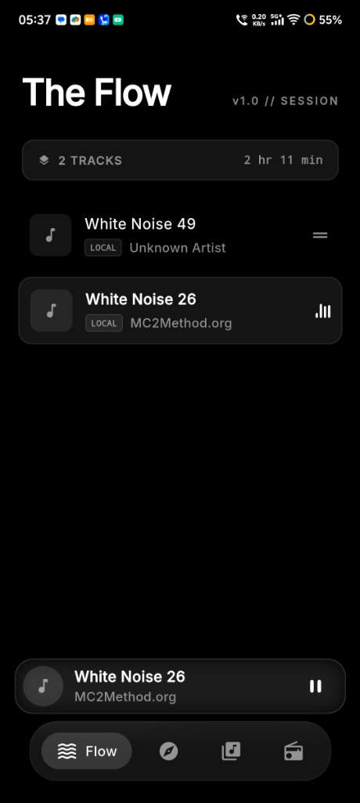
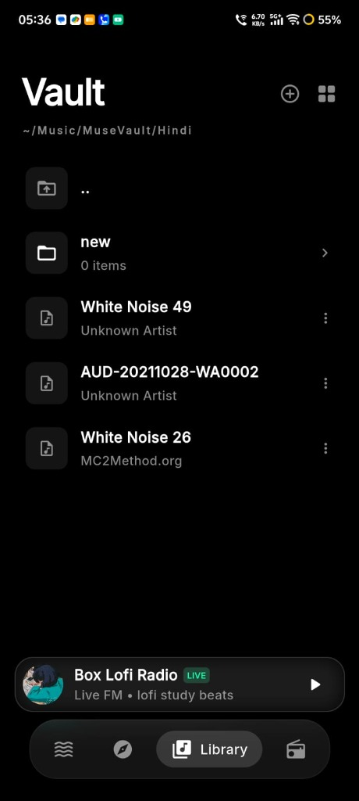
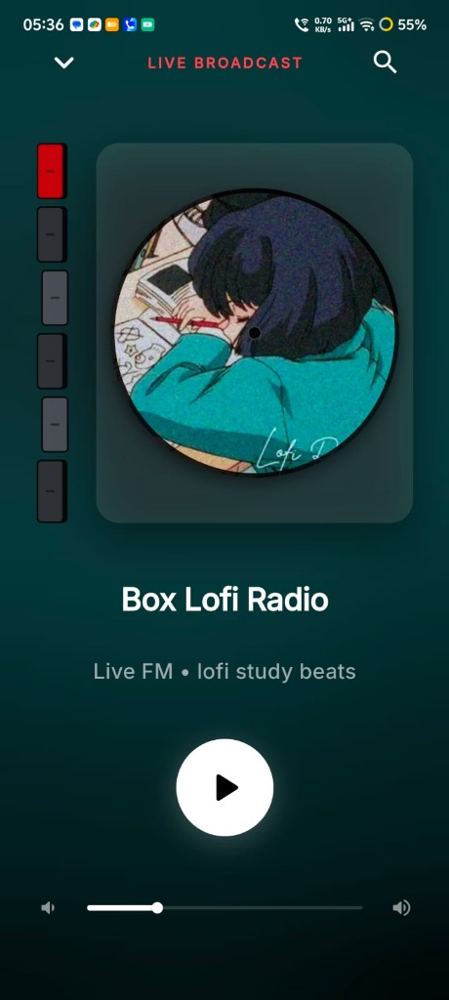
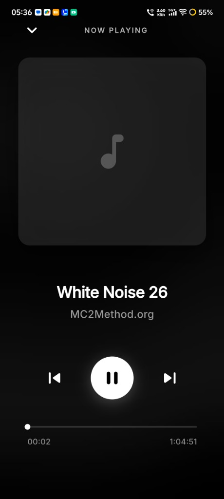

<div align="center">

# 🎵 Muse OS

**A tactile, offline-first music operating system and audio exploration environment.**  
*Engineered with Flutter, Isar Graph Database, and Deep Metric Learning Audio Research.*

[](https://flutter.dev)
[](https://dart.dev)
[](https://isar.dev)
[]()
[]()

</div>

---

## 📸 Interface Preview

<div align="center">
  <table>
    <tr>
      <td align="center" width="25%">
        <br />
        <b>The Flow</b><br />
        <i>Dynamic Queue, Drag Reorder & Live Runtime</i>
      </td>
      <td align="center" width="25%">
        <br />
        <b>The Vault</b><br />
        <i>Filesystem-driven Local Hierarchy</i>
      </td>
      <td align="center" width="25%">
        <br />
        <b>Radio Deck</b><br />
        <i>Spinning Vinyl & Tactile Mechanical Presets</i>
      </td>
      <td align="center" width="25%">
        <br />
        <b>Now Playing</b><br />
        <i>Living Dynamic Aura & Ergonomic Playback</i>
      </td>
    </tr>
  </table>
</div>

---

## ⚡ Core Philosophy & Design System

Muse combines high-performance native audio architecture with a dual-domain visual design language:

### Glassy Sky
- **Frosted Glassmorphism (`MuseGlass`)**: Custom backdrop filters with subtle luminous borders and dark translucent acrylic shells.
- **Living Dynamic Aura**: The `LivingAuraBackground` samples dominant, vibrant, and dark pigments from active album artwork in real time using `PaletteGenerator`, driving a continuous radial gradient drift.
- **Adaptive Equalizer & Marquee**: Interactive sine-wave equalizer visualizers and layout-safe text tickers.

### Walkman
- **Mechanical Tactile Primitives (`MuseTactileButton`)**: Physics-modeled spring buttons with depressed physical states, shadows, and device vibration haptics.
- **Hardware Radio Deck**: Authentic 6-slot preset matrix with tap-to-tune and long-press-to-burn functionality into persistent local storage.
- **Turntable & Reel Visualizers**: Rotating vinyl deck and cassette reel animations synchronized with audio playback states.

---

## ✨ Features

### 🎛️ 1. The Flow (`FlowPage`)
- **Queue Management**: Real-time queue session tracking displaying total tracks and total calculated runtime (e.g. `2 hr 11 min`).
- **Smooth Reordering**: `SliverReorderableList` implementation with tactile drag handles.
- **Swipe-to-Dismiss**: Remove tracks with directional dismissible tiles; protects the currently playing track from accidental dismissal.
- **Source Badges**: Clear monochrome tags identifying track origins (`LOCAL`, `SC`, `YT`, `JM`, `ARC`).

### 🗄️ 2. The Vault (`CollectionPage` & `CollectionController`)
- **Set-Theoretic Sync Engine**: Performs automatic set reconciliation between physical disk files ($P$) and database index ($L$):
  - $P \setminus L$: Indexes newly discovered physical files.
  - $L \setminus P$: Purges orphaned metadata for removed files.
- **Stray File Sweeper**: Automatically collects loose audio files found in the root vault directory into a managed `Stray/` folder.
- **`.muse_id` Persistent Inodes**: Writes a unique UUID marker file into each physical directory. Folders can be renamed or reorganized in external file managers without breaking database relations or playlists.
- **Multi-Select & Batch Archiving**: Long-press drag multi-selection gesture with coordinate-based item index resolution.
- **ZIP Pack & Share**: Asynchronously compresses selected songs/folders into `.zip` archives with a progress dialogue, ready for system-native sharing via `share_plus`.
- **Virtual Stream Shortcuts**: Store network tracks and internet streams alongside physical local MP3s as lightweight `stream://` shortcuts.

### 📻 3. The Radio Deck (`RadioDashboardPage` & `RadioListenPage`)
- **Global Tuner**: Searches thousands of live broadcast streams powered by the Radio Browser open API.
- **Hardware Preset Memory**: 6 physical-style preset slots backed by the local Isar database.
- **Breathing Speaker Cone & Turntable**: Interactive audio visualizer with reactive glow radius and smooth spinning vinyl disc.
- **OS Hardware Volume Control**: Bidirectional synchronization with system volume via `FlutterVolumeController`.

### 🔍 4. Federated Multi-Provider Discovery (`SearchPage`)
- **JIT Progressive Aggregation**: Multi-threaded parallel query execution across active providers. Results are rendered immediately as each provider responds, eliminating network bottlenecks.
- **Recent Search History**: Persistent search logs with swipe-to-remove and automatic 7-day TTL garbage collection.
- **Live Telemetry Filtering**: Source pills with real-time result counters (`ALL`, `LOCAL`, `RADIO`, etc.).

### 🔮 5. The MuseOrb & Background Engine
- **Smart Session Routing**: Floating mini-orb anchored above navigation dock automatically delegates playback between local queues and live radio streams.
- **OS Background Services**: Full Android media session integration with lockscreen controls, notification artwork, and skip protections via `just_audio_background`.
- **Skip Race-Condition Safeguards**: Incremental request IDs prevent stale audio stream overwrites during fast track skipping.

---

## 📡 Music Providers

Muse includes a standardized `MusicProvider` interface supporting local media and federated streaming sources:

| Source | Identifier | Mechanism |
| :--- | :--- | :--- |
| **Local Storage** | `LocalMusicProvider` | Scans device audio via `on_audio_query`, parses ID3 metadata, and caches SHA-1 artwork. |
| **Radio Browser** | `RadioProvider` | Discovers live station streams via round-robin DNS endpoints with genre/tag filters. |
| **SoundCloud** | `SoundCloudProvider` | Dynamically intercepts client tokens from web bundles, resolves private API endpoints and progressive MP3/HLS streams. |
| **YouTube** | `YouTubeProvider` | On-demand audio-only stream extraction via `youtube_explode_dart`. |
| **Jamendo** | `JamendoProvider` | Accesses royalty-free open audio catalog using client APIs. |
| **Audius** | `AudiusProvider` | Resolves decentralized node infrastructure to query Web3 audio streams. |
| **Internet Archive** | `ArchiveProvider` | Queries `archive.org` audio collections with direct MP3 download streaming. |

> **Compliance Note**: Configurable via `isPlayStoreMode` in `provider_config.dart`. When enabled, restricts queries exclusively to Local storage and Radio Browser.

---

## 🧠 Machine Learning: Audio Metric Learning (`ML/`)

The repository includes research experiments in **Deep Metric Learning** for audio representations and content similarity:

```
ML/
├── Ablation 0 - Hyperparameter tuning/   # Batch size (16 vs 64) and Adaptive Learning Rate (ALR)
└── Ablation 1 - Model tuning/            # Comparative analysis across network architectures
```

### Ablation 1: Architecture Comparison

Models trained with Triplet Loss to optimize embedding manifolds for audio similarity:

| Model Architecture | KNN Accuracy | Silhouette Score | mAP@64 | Composite Index |
| :--- | :---: | :---: | :---: | :---: |
| **ResNet-1D** | 71.0% | **0.547** | **0.650** | **0.6282** |
| **ResNet-18** | **73.0%** | **0.551** | 0.627 | 0.6275 |
| **CNN + Attention** | 68.0% | 0.476 | 0.594 | 0.5710 |
| **Baseline CNN** | 69.5% | 0.486 | 0.610 | 0.5840 |
| **EfficientNet-B0** | 52.0% | 0.397 | 0.432 | 0.4440 |

*Key Findings: 1D convolutions and ResNet-18 backbones significantly outperformed EfficientNet on raw audio/spectrogram embeddings, with larger batch sizes ($bs=64$) preventing triplet starvation.*

---

## 📂 Repository Structure

```
.
├── assets/
│   └── screenshots/              # UI interface captures
├── ML/                           # PyTorch metric learning experiments & notebooks
│   ├── Ablation 0 - Hyperparameter tuning/
│   └── Ablation 1 - Model tuning/
└── muse/                         # Flutter Application
    ├── lib/
    │   ├── core/
    │   │   ├── services/         # StorageService, MetadataService
    │   │   ├── theme/            # AppColors, Typography, ThemeProvider
    │   │   └── widgets/          # MuseGlass, MuseTactileButton
    │   ├── features/
    │   │   ├── flow/             # Queue management & session overview
    │   │   ├── library/          # Vault file explorer & zip packing
    │   │   ├── player/           # ListenPage, MuseOrb, AudioService
    │   │   ├── radio_player/     # Live radio deck, presets & audio engine
    │   │   ├── root/             # Navigation dock & multi-select actions
    │   │   └── search/           # Federated search, telemetry & history
    │   ├── models/               # Song domain models & sources
    │   └── providers/            # Music provider implementations
    └── packages/
        └── muse_local_db/        # Standalone Isar persistence library
            └── lib/src/
                ├── models/       # FolderEntity, SongEntity, RadioPresetEntity
                └── services/     # DatabaseService, TTL Garbage Collector
```

---

## 🚀 Getting Started

### Prerequisites

- [Flutter SDK](https://docs.flutter.dev/get-started/install) (`^3.9.2` or later)
- [Dart SDK](https://dart.dev/get-dart)
- Android SDK (API 34 recommended)

### Setup & Installation

1. **Clone the repository:**
   ```bash
   git clone https://github.com/Jeffrey-joe-mathews/Muse.git
   cd Muse
   ```

2. **Generate Database Bindings (`muse_local_db`):**
   ```bash
   cd muse/packages/muse_local_db
   flutter pub get
   dart run build_runner build --delete-conflicting-outputs
   ```

3. **Install App Dependencies:**
   ```bash
   cd ../..
   cd muse
   flutter pub get
   ```

4. **Launch the App:**
   ```bash
   flutter run
   ```

---

## 🔒 Android Permissions

Muse operates with physical directory synchronization and requires the following permissions declared in AndroidManifest:

- `READ_MEDIA_AUDIO` / `READ_EXTERNAL_STORAGE`: Access to local music files.
- `MANAGE_EXTERNAL_STORAGE`: Used to create and maintain `~/Music/MuseVault` and write `.muse_id` tracking inodes.
- `VIBRATE`: Tactile haptic feedback on button interactions.
- `INTERNET`: Live radio stream playback and cloud provider discovery.
- `FOREGROUND_SERVICE` & `FOREGROUND_SERVICE_MEDIA_PLAYBACK`: Persistent background audio playback.

---

<div align="center">
  <sub>Crafted with passion by Jeffrey Joe Mathews .</sub>
</div>
